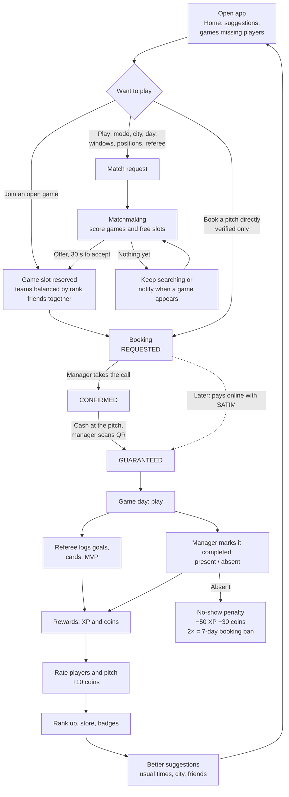
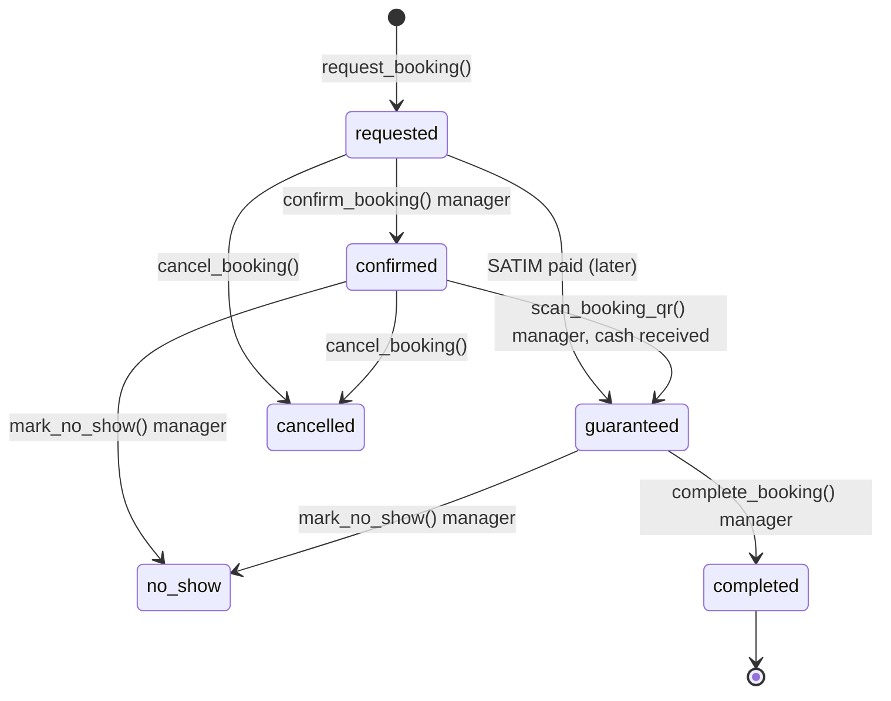
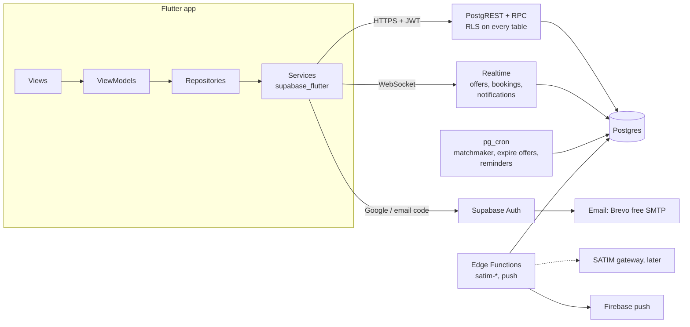

# Matchiko architecture

Matchiko organises small football games (3v3 up to 11v11, sized per pitch) in Algeria: it gets
enough players together, finds a free pitch, and stops no-shows in a mostly
cash market. This doc is the map: the main loop, how it runs on Flutter +
Supabase, and where each rule is enforced.

Product decisions come from the design hand-off (`design/prototype/BRIEF.md`,
`design/chats/chat1.md`) and `docs/PRODUCT.md` (full feature spec, cash-market
rules, screen inventory). The prototype `design/prototype/Matchiko.html` is the
visual reference for every screen.

## 1. Stack

| Layer | Choice | Why |
|---|---|---|
| App | **Flutter** (Dart 3, Android first, iOS from the same code) | Draws its own pixels, so the custom design (zellij patterns, diamond nav button, pitch drawings) matches exactly on every phone. Solid RTL for Arabic. Fast on the low-end Android phones common in Algeria. Official Supabase SDK. |
| State | **Riverpod** (`flutter_riverpod`, plain providers and `Notifier`s, no codegen) + **freezed** / `json_serializable` models | Compile-safe dependency injection, easy overrides in tests, data refreshes from one change stream. Immutable models with `copyWith` and JSON. See the `kiss-flutter` skill. |
| Navigation | `go_router` | Declarative routes, role-based redirects, deep links later. |
| Backend | **Supabase**, hosted in **Paris (eu-west-3)**: Postgres + RLS, Auth, Realtime, Storage, Edge Functions, pg_cron | One managed service, closest region to Algeria. Business rules live in Postgres next to the data, so a modified app can't break them. Free plan covers launch (50k monthly users, 500 MB DB); move to Pro ($25/mo) before real traffic, because free projects pause after 7 idle days. |
| Sign-in | **Google** (native, one tap on Android) + **6-digit code by email**. No SMS at launch. | Free. SMS to Algeria costs ~$0.20–0.30 each (≈ $300+ for the first 1,000 users with re-logins). See § Sign-in. |
| Payments | **Cash at the pitch** (QR scan) at launch. SATIM (CIB / Edahabia) later. | Cash is how people pay today; SATIM needs a bank contract. The schema already has `payments` and the `requested → guaranteed` transition for it. |
| Push | Firebase Cloud Messaging, sent from an Edge Function | Standard on Android. |

**Why not React Native:** I first suggested it only because the prototype is
HTML/JS. Flutter is the better fit here: the design is fully custom (Flutter
paints it pixel for pixel), the market is mostly low/mid-range Android, and
`supabase_flutter` is official. React Native's only real advantage would be
sharing code with a React website, which isn't planned.

## 2. The big loop

Everything in the app serves one cycle. Each turn of it should make the next
one easier (better matches, more trust, more coins), which is what keeps people
coming back.



Three smaller loops feed the main one:

- **Trust loop.** A player shows their verification QR to any stadium
  manager, who checks the ID card in person (name, photo, age 16+) and taps
  Verify (+200 coins). Only verified players can book a pitch; anyone can join
  a game. Verified players can apply to referee, and a manager approves them.
- **Manager loop.** Today's timeline: call the requester → **Confirm**; at the
  pitch, scan the QR after the cash → **Guaranteed**; after the game →
  **Complete** (mark absent players) or **No-show**.
- **Penalty loop.** No-shows cost XP and coins, and 2 no-shows mean a 7-day
  booking ban. Reliability is visible on the profile, so people show up.

## 3. Booking state machine

Enforced in Postgres (`bookings_status_guard` trigger + the RPCs). The app's
`BookingStatus` enum is a copy for display only.



## 4. System view



Rules of thumb:

- **The app is untrusted.** It reads through RLS and changes important state
  only by calling RPCs (`supabase.rpc('confirm_booking', ...)`). Prices,
  rewards, roles and statuses are computed on the server.
- **Edge Functions only for what Postgres can't do:** talking to SATIM, sending
  push, and later heavier matchmaking. Everything else is SQL.
- **Realtime for the live parts:** the 30-second offer, booking status changes
  for the player, new requests for the manager.

## 5. Data model

Migrations: `supabase/migrations/`. Tests: `supabase/tests/database/`.

| Area | Tables | Notes |
|---|---|---|
| People | `profiles` | Public: handle, name, avatar, city, positions, verified, XP. Private (only through `get_my_profile()`): phone, coins, no-show count, ban. Managers get a booker's phone through `booking_contact()`. |
| Places | `cities`, `venues`, `pitches`, `venue_managers` | A venue (complex) has several pitches; each pitch has a `max_per_side` (e.g. 7 or 11) and each game picks its `per_side` up to it. Managers are linked to venues, which is what makes someone a manager. |
| Roles | `referees`, `referee_applications`, `verification_requests` | Referee = verified player approved by a manager. |
| Games | `bookings`, `booking_tickets`, `games`, `game_players` | One booking = one 1-hour slot = one game. `booking_tickets` holds the QR secret (booker only). An exclusion constraint prevents double booking. |
| Money | `payments` | SATIM orders (later). Service role only. |
| Matchmaking | `match_requests`, `match_offers`, `teams`, `team_members`, `friendships` | A request stores mode, friends/team, positions in order, city, day, windows, radius, referee wish. |
| After the game | `match_events`, `player_ratings`, `pitch_ratings` | Written through `submit_match_report()` and `rate_game()`. |
| Rewards | `wallet_ledger`, `reward_rules` | Append-only ledger, each reward paid once per (user, reason, game). Amounts are data (tunable without a release). |
| Inbox | `notifications` | Feeds the in-app inbox and push. |

## 6. Matchmaking (the key feature)

**v1, SQL only (milestone M4):**

1. The player creates a `match_request` (Play screen).
2. A `find_matches()` function runs on insert and every ~15 s via pg_cron. For
   each searching request it scores candidates:
   - **open games** in the same city, day and time window, same format, with a
     free spot for one of the wanted positions (the first choice scores
     higher), and for friends/team mode enough spots on one side;
   - **free slots** at pitches within the radius, when enough compatible
     requests are waiting to fill a game (pooling).

   Suggested score: `position fit (40) + time fit (20) + distance (20) +
   rank closeness (15) + friend/usual-pitch bonus (5)`.
3. The best candidate becomes a `match_offer` (30 s, pushed through Realtime).
   Accept → join the game (team chosen by balance: average XP per side, tagged
   friends kept together). Decline or timeout → next candidate.
4. When a pooled game fills, the system books the slot as `requested` for the
   manager to confirm, like any booking.

**v2 (milestone M7): suggestions.** Use history (usual days, times, pitches,
friends) for a "Suggested for you" feed and pushes like "Yacine is playing
tonight at Kouba, 1 spot left". Same scoring, run ahead of time.

## 7. Security model

Full checklist: `.claude/skills/matchiko-security/SKILL.md`. Summary:

- RLS on every table. Supabase grants everything to `anon`/`authenticated` by
  default, so the migrations **revoke all and re-grant** table by table and
  column by column. A pgTAP test fails if any table lacks RLS or if `anon` has
  any table privilege.
- Every write that matters goes through a `security definer` function with
  `search_path = ''` that checks the caller and their venue.
- Roles come from tables (`venue_managers`, `referees`), never from JWT
  `user_metadata`.
- QR codes are random 128-bit tokens, readable only by the booker, and only
  work for a manager of that venue.
- SATIM (later): the Edge Function computes the amount from the booking, and the
  callback re-checks the order status with SATIM before marking it paid
  (idempotent).
- No ID photos are stored: verification happens in person. Only avatars go to
  Storage.
- The app ships only the Supabase URL and the publishable key.

## 8. Repo layout

```
app/                  Flutter app
  lib/core/           app infrastructure, no business types: env, router
                      (role redirects), theme tokens, generic widgets,
                      format helpers, settings (language)
  lib/shared/         vocabulary every feature uses: domain/ (freezed models
                      + repository interfaces), data/ (demo repository),
                      widgets/ (badges, ticket, pitch turf), providers.dart
  lib/features/<f>/   feature-first: domain/ data/ presentation/ (only the
                      layers the feature needs). Features never import each
                      other; the router composes them.
  lib/l10n/           ARB files en/fr/ar (generated from the prototype)
supabase/
  config.toml         local Supabase (Google + email code auth)
  migrations/         schema, RLS, RPCs
  seed.sql            local dev data (3 Alger venues, test users)
  tests/database/     pgTAP tests
  tests/local/        run tests on plain Postgres when Docker isn't available
design/               Claude Design hand-off (prototype, brief, chat, tools)
docs/                 this file, PRODUCT.md, ROADMAP.md, AI_WORKFLOW.md, economy/
.claude/skills/       agent skills (Flutter, Dart, Supabase, security)
```

## 9. Sign-in (decided: free)

| Option | Cost for ~1,000 users | Verdict |
|---|---|---|
| **Google sign-in** (native) | Free (inside Supabase's 50k monthly users) | **Main button.** Nearly every Android phone already has a Google account. |
| **Email code** (Supabase OTP + Brevo SMTP) | Free (Brevo: 300 emails/day; Resend: 100/day, 3,000/month) | **Fallback** for people who don't want Google. |
| SMS code (Twilio/Plivo to Algeria) | ~$0.20–0.32 per SMS | Too expensive for launch. |
| Firebase phone auth | 10 free SMS/day, then per-SMS, needs a billing account | Same cost problem. |
| Telegram Gateway | $0.01 per delivered code | Cheap, but many players won't have Telegram. Option later via the Send SMS hook. |
| WhatsApp authentication template | A few US cents per code (Meta's rate card) | Best paid option later (everyone has WhatsApp), via the Send SMS hook + an Edge Function. |

The **phone number is still required** (managers call to confirm bookings).
It's a private profile field, checked in person by the manager during ID
verification, so no SMS is needed to trust it. Sources: [Firebase pricing
summary](https://blog.logto.io/it/firebase-authentication-pricing),
[Telegram Gateway](https://core.telegram.org/gateway), [Plivo
Algeria](https://www.plivo.com/sms/pricing/dz/), [Supabase Send SMS
hook](https://supabase.com/docs/guides/auth/auth-hooks/send-sms-hook),
[Brevo](https://www.techradar.com/pro/software-services/brevo-review),
[Resend](https://automationatlas.io/answers/resend-free-tier-explained-2026/).

## 10. Decisions log

| Decision | Choice |
|---|---|
| Sign-in | Google + email code (free); WhatsApp OTP later if needed |
| Supabase region | Paris (eu-west-3) |
| Online payment | Later (no SATIM at launch) |
| XP per action | Monte Carlo model, see `docs/economy/REWARDS.md` |
| App id | `dz.bmgdev.matchiko` (BMG.dev) |
| Maps / distance | Plain lat/lng + Haversine first; PostGIS when needed (M4) |
